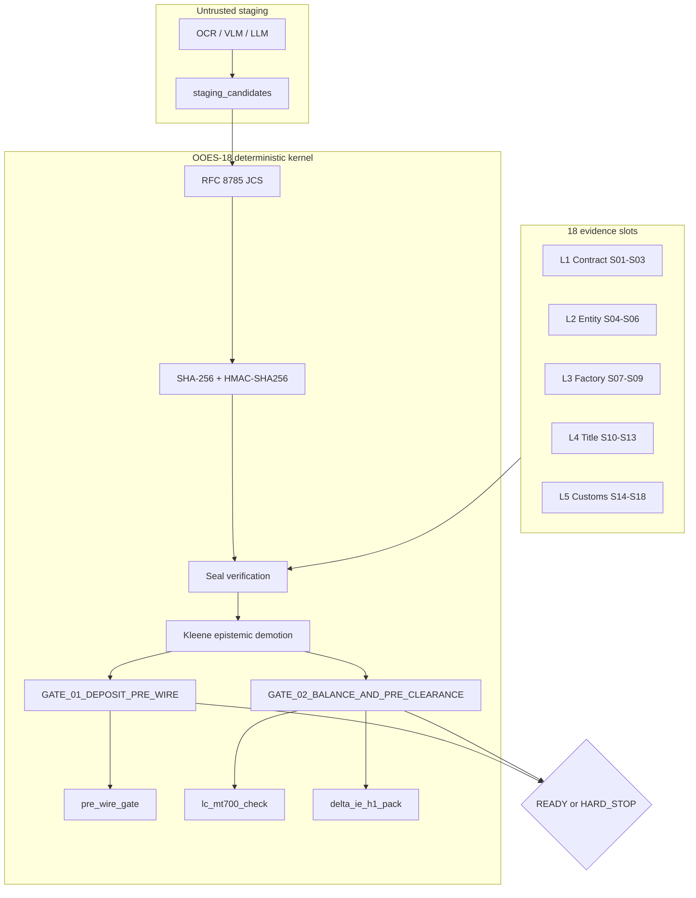

# OOES-18

## An Open Deterministic Evidence Schema for EU Regulation 2024/3015 and French DELTA IE (H1) Pre-Clearance

**Specification version:** 1.1.0 (October 2026)  
**Author:** Mohammad Anwaruzzaman  
**ORCID:** [0009-0004-5697-7634](https://orcid.org/0009-0004-5697-7634)  
**Institutional affiliation:** Founder & Chief Architect, First Order Technologies SAS (Paris, France - in incorporation)  
**Companion empirical paper:** DS-PR412, SSRN [#6661398](https://ssrn.com/abstract=6661398), DOI [10.2139/ssrn.6661398](https://doi.org/10.2139/ssrn.6661398)  
**Reference implementation:** `@foin/crisis-engine` (private production monorepo; the public verifier in this repository has no runtime dependencies)

**License:** Written specification (`README.md`, `spec/`) is CC-BY-4.0. Schemas, test vectors, reference verifier, tests, and the test trust store (`schema/`, `vectors/`, `src/`, `tests/`, `trust/`) are Apache-2.0. See [LICENSE](LICENSE).

---

> *"A model reads. A compiled kernel decides."*

OOES-18 is an open, deterministic evidence schema for cross-border manufacturing orders. It fixes 18 evidentiary slots across five layers, a strict three-valued epistemic lattice, two release gates, and a cryptographic protocol built from RFC 8785 JCS, RFC 5869 HKDF-SHA256, HMAC-SHA256, AES-256-GCM, and Ed25519 attestation signatures. Probabilistic extraction may populate an untrusted staging area, but no confidence score, fuzzy match, or heuristic weight is permitted in the release path. The release predicate is total and deterministic:

```text
Gamma : D -> {READY, HARD_STOP} x P(R_halt)
```

The repository ships a TypeScript verifier with no runtime dependencies beyond Node built-ins, a deterministically generated test vector, a Draft 2020-12 JSON Schema, an Ed25519 attester trust store, and an automated test suite proving seal integrity, attestation authenticity, epistemic demotion, cross-slot reconciliation, origin-regime consistency, and blind-index collision behavior.

---

## 1. Regulatory Context: Three European Mandates Converge

European import compliance is moving from document inspection after cargo has sailed to structured, machine-verifiable evidence before capital is released. Three regimes create the demand for OOES-18.

### 1.1 EU Forced Labour Regulation (EU) 2024/3015

Regulation (EU) 2024/3015 entered into force on **13 December 2024** and becomes strictly enforceable from **14 December 2027**. It empowers EU customs authorities to detain, prohibit, or withdraw goods where forced labour is suspected anywhere in the value chain. For apparel and workwear importers, the operational risk is not only a named factory. It is opaque unauthorized sub-tier subcontracting: a compliant tier-1 factory can route production to an unregistered shadow unit that never appears in the purchase order, the audit, or the origin statement.

OOES-18 addresses this by requiring a corroborated supplier KYB slot (`L2.S04`), a registry-standing and forced-labour screening slot (`L2.S05`), and a capacity attestation that explicitly records `subcontracting_authorized: false` plus tier-2 mill tax identifiers (`L2.S06`). `GATE_01_DEPOSIT_PRE_WIRE` blocks the Day-0 30% advance unless all three are independently corroborated.

### 1.2 French DGDDI DELTA IE Volet Import (H1)

French customs replaced DELTA G/X with **DELTA IE Volet Import (H1)** under the EU UCC Customs Data Model. Since **30 September 2025**, H1 pre-arrival declarations are mandatory across French ports including Le Havre and Marseille-Fos. The declaration requires structured data elements that legacy invoice PDFs do not reliably provide: declared value and Incoterms breakdown, 10-digit TARIC code, preferential and non-preferential origin, supporting document codes, importer EORI, exporter identity, container number, and ISO 17712 seal number.

OOES-18 maps directly to those data elements in the `delta_ie_h1_pack` institutional view. The mapping is normative. The same evidence that clears the treasury gate also populates the customs pre-clearance pack.

### 1.3 Ecodesign for Sustainable Products Regulation (ESPR) (EU) 2024/1781

ESPR introduces the Textile Digital Product Passport (DPP). A credible DPP requires batch-level chemical evidence (REACH Annex XVII), fiber composition, and origin provenance. OOES-18 places the ISO/IEC 17025 laboratory certificate at `L3.S09`, including azo-dye concentration, measured cotton percentage, REACH compliance, and the DPP unique identifier. The technical pack at `L1.S02` carries the fiber and GSM baseline. The gate compares the measured value to the specification rather than trusting a self-declared label.

### 1.4 The structural gap

These mandates share a common demand: origin and product claims must be independently corroborated, not merely asserted. Existing document workflows produce assertions. OOES-18 produces a deterministic epistemic state.

---

## 2. Empirical Anchor: DS-PR412

The companion paper **DS-PR412** is *First-Order Manufacturing Failure in Small-Firm International Sourcing: A Practice-Derived Cascade Model from 412 Cases (DS-PR412, 2011–2024)*, SSRN [#6661398](https://ssrn.com/abstract=6661398), DOI [10.2139/ssrn.6661398](https://doi.org/10.2139/ssrn.6661398). It is a two-page, practice-derived working paper based on 412 first manufacturing orders placed by small founder-led firms with overseas factories in Bangladesh, Vietnam, China, India, South Korea, and Thailand across five product categories between 2011 and 2024. The dataset is author-coded; the paper states that an inter-rater reliability review is in progress.

| Measure | Value |
| :--- | :--- |
| Orders analyzed | 412 first orders |
| Adverse operational/documentary events | **59 / 412 = 14.32%** (approximately 1 in 7) |
| Reference contract-to-arrival window | **75 days** (the workflow assumption used in this specification, not a DS-PR412 mean) |
| Gap definition | Day-0 advance telegraphic transfer (30% T/T deposit) to destination port arrival |
| OOES-18 operational failure classes | Quality defects, unauthorized shadow subcontracting, late or forged shipping documents, TARIC/origin misclassification (the specification's grouping, not a DS-PR412 classification) |

The 75-day window is the core structural problem modeled here. At `t_0`, the importer wires 30% of contract value against promises and paper. At `t_75`, the cargo arrives and the physical truth becomes observable. During that window, capital is exposed to evidence that has not been independently verified. The 14.32% figure is descriptive of the coded dataset, not a causal estimate or a population parameter.

Legacy post-presentation bank OCR operates at `t_45` to `t_60`, after capital is deployed and the vessel has sailed. It can detect a discrepancy in a PDF, but it cannot establish that the factory that produced the goods is the factory that was audited, that the container was stuffed at the declared geofence, or that the laboratory reading was not altered after capture. Consortium trade-finance blockchains (Marco Polo, we.trade, TradeLens) addressed ledger sharing, not local origin capture. They failed commercially for governance, onboarding, and incentive reasons, and placing commercial metadata on a shared ledger did not solve the duplicate-pledge problem under privacy constraints.

OOES-18 is deliberately narrower. It standardizes the evidence object, the epistemic state, the deterministic gate, and the cross-lender collision token. It does not require a consortium ledger.

The private production engine `@foin/crisis-engine` provides the operational reference implementation. This repository intentionally does not cite unverifiable line-of-code or pass-rate metrics; the public verifier and its 17-test suite are the reproducible evidence base.

---

## 3. Architecture

### 3.1 Five layers, eighteen slots

| Layer | Purpose | Slots |
| :--- | :--- | :--- |
| **L1 Contract** | Commercial intent and the physical baseline | `S01` Purchase Order, `S02` Tech Pack/BOM, `S03` Golden Sample |
| **L2 Entity** | Who the supplier is and whether it is allowed to produce | `S04` Supplier KYB, `S05` Registry Standing, `S06` Capacity Attestation |
| **L3 Factory** | Proof that production physically occurred at the declared site | `S07` Geotagged Media, `S08` Inline AQL, `S09` ISO 17025 Lab Certificate |
| **L4 Title** | Custody, transport, origin, and settlement instruments | `S10` Bolt Seal, `S11` Bill of Lading, `S12` Origin Proof (certificate or REX), `S13` Settlement Instrument |
| **L5 Customs** | Valuation, duty, inspection, telemetry, and the state root | `S14` Landed Valuation, `S15` Duty Calculation, `S16` PSI Report, `S17` GPS Telemetry, `S18` Audit Signature |

Each slot is exactly one of `UNKNOWN`, `ASSERTED`, or `CORROBORATED`. A mandatory slot in `UNKNOWN` or `ASSERTED` cannot satisfy a release gate that requires `CORROBORATED`.

### 3.2 Epistemic lattice

```text
UNKNOWN (0)  <  ASSERTED (1)  <  CORROBORATED (2)
```

The lattice is Kleene's strong three-valued logic restricted to a bounded chain:

- **UNKNOWN:** missing, unsubmitted, expired, structurally invalid, or cryptographically unauthenticated. Never coerced to truthy.
- **ASSERTED:** structurally valid and signed by an interested party with capture provenance, but not independently attested.
- **CORROBORATED:** structurally valid, cryptographically sealed, and independently attested by an accredited third party or authority with a verified Ed25519 signature, a non-expired attestation, and a public key present in the relying party's trust store.

A seal mismatch or an expired attestation forces immediate demotion to `UNKNOWN` with `ERR_SEAL_INTEGRITY_FAILURE` or `ERR_ATTESTATION_EXPIRED`.

### 3.3 Two deterministic release gates



| Gate | Trigger | Mandatory slots | Key semantic rules |
| :--- | :--- | :--- | :--- |
| `GATE_01_DEPOSIT_PRE_WIRE` | Day-0 30% T/T advance | `S01-S06` | Sanctions clear, EU 2024/3015 screening `CLEAR`, subcontracting unauthorized, capacity positive |
| `GATE_02_BALANCE_AND_PRE_CLEARANCE` | Pre-shipment / UCP 600 presentation / DELTA IE H1 | Core `S01,S02,S03,S04,S07,S08,S09,S10` + reconciliation `S05,S11,S12,S14,S15,S16` (14 total) | Factory/media and factory/stuffing geofences <= 500 m, AQL pass, REACH and azo < 30 ppm, cotton tolerance, container and carrier consistency, clean on board, origin criterion and regime, REX consistency, CIF arithmetic, TARIC format |

A semantic check is evaluated only when every source slot is `CORROBORATED`. If a source slot is `ASSERTED` or `UNKNOWN`, the check returns `NOT_EVALUATED` and cannot contribute a `PASS`. This prevents a gate from relying on data it does not require.

### 3.4 Cryptographic protocol

1. **RFC 8785 JCS** canonicalizes every payload. Object keys are sorted by UTF-16 code units, arrays keep order, numbers use ECMA-262 serialization, and non-finite numbers are rejected.
2. **RFC 5869 HKDF-SHA256** derives a distinct 32-byte slot key from the tenant master secret, a 16-byte dossier salt, and the info string `OOES-18|v1|<tenant>|<dossier>|<slot>`.
3. **HMAC-SHA256** produces the deterministic slot authentication digest over the canonical payload.
4. **AES-256-GCM** encrypts the payload at rest with a 12-byte IV and AAD `<dossier>|<slot>|<state>`.
5. **Ed25519 attestation signature** covers a canonical message containing the slot ID, the JCS SHA-256 of the payload, the attester identity, accreditation ID, validity window, and public key. The signature is 64 bytes. A relying party verifies it with the attester's public key from a trust store; the tenant master secret is not required.
6. **Dossier state root** at `L5.S18` hashes the ordered `S01..S17` tuple of slot identifier, state, and authenticated digest.
7. **Salted blind index** normalizes the shipment tuple `(B/L, container, supplier tax ID, invoice date)`, strips spaces and hyphens from the container and tax identifier, and emits `HMAC-SHA256(network_registry_salt, normalized_tuple)`. Two banks can detect the same shipment without sharing tenant keys or commercial plaintext.

The tenant HMAC seal and the attester signature serve different purposes. The HMAC seal is a tenant-side integrity and confidentiality control; it is not independent evidence because it is derived from the tenant master secret. The Ed25519 signature is the relying-party proof: it binds the exact payload hash to an attester key that the relying party has chosen to trust. A `CORROBORATED` slot without a trusted Ed25519 attestation is demoted to `UNKNOWN` with `ERR_ATTESTATION_UNTRUSTED`.

---

## 4. Repository Map

```text
.
├── README.md
├── LICENSE
├── package.json
├── tsconfig.json
├── schema/
│   └── ooes-18.schema.json                  Draft 2020-12, strict, 18 slot payloads
├── spec/
│   ├── OOES-18-Specification-v1.1.md        Full technical specification
│   ├── OOES-18-Paper.tex                    4-page two-column SSRN preprint source
│   └── OOES-18-Paper.pdf                    Compiled 4-page preprint
├── src/
│   ├── verifier.ts                          Deterministic kernel with Ed25519 attestation verification
│   ├── seal-vector.ts                       Deterministic vector and trust-store generator
│   └── cli.ts                               verify / tamper-demo forensic CLI
├── tests/
│   └── verifier.test.ts                     17 node:test assertions
├── trust/
│   └── attesters.json                       Test attester public keys and scopes
└── vectors/
    └── CASCADE-2026-9F4A2C.dossier.json     Deterministic Dhaka -> Le Havre dossier
```

The compiled verifier imports only Node built-ins: `node:crypto`, `node:fs`, `node:path`, `node:test`, and `node:assert/strict`. There are no runtime dependencies.

---

## 5. Quickstart

```bash
npm install
npm run build
npm run seal-vector
npm test
npm run verify
npm run verify-attestations
npm run tamper-demo
```

`npm run seal-vector` regenerates `vectors/CASCADE-2026-9F4A2C.dossier.json` and `trust/attesters.json` from the pinned test keys. Every digest, authentication tag, Ed25519 signature, state root, and blind index in those files is computed by Node's cryptographic engine; no hexadecimal value is hand-authored.

`npm run verify-attestations` is the relying-party path. It does not use the tenant master secret: it recomputes each payload's JCS SHA-256, verifies the Ed25519 attestation with the public key, and checks that every `CORROBORATED` key is in `trust/attesters.json`. A bank, insurer, or customs broker can run this against a submitted dossier.

```text
L3.S09_LAB_CERTIFICATE: TRUSTED | payload MATCH | signature VALID | trust YES
L4.S11_BILL_OF_LADING: SELF-DECLARED | payload MATCH | signature VALID | trust NO
RESULT: all attestations verify; every CORROBORATED slot is backed by a trusted key.
```

### 5.1 Test results

```text
# tests 17
# suites 0
# pass 17
# fail 0
# cancelled 0
# skipped 0
# todo 0
```

The suite covers:

1. RFC 8785 key-order invariance, Unicode escaping, ECMA-262 numbers, and rejection of `NaN`, `Infinity`, `undefined`, non-plain objects, and cycles.
2. HKDF-SHA256 domain separation across tenant, dossier, and slot identifiers.
3. Authentic seal verification for all 18 slots in `CASCADE-2026-9F4A2C`.
4. Default gate failure with the exact `ASSERTED` and `UNKNOWN` slot sets.
5. Full corroboration promotion to `READY` on both gates.
6. Semantic rejection with valid seals: container mismatch, factory/media geofence, factory/stuffing geofence, `WO` origin with imported inputs, carrier/SCAC mismatch, and CIF arithmetic error.
7. Ed25519 attestation rejection: a valid signature from an untrusted key, and a mutated signature.
8. Cross-bank blind-index collision under formatting mutation.
9. Single-byte tamper demotion and `GATE_02` halt.
10. Deterministic repeatability of both gates and the seal report.

### 5.2 `npm run verify`

The default vector represents a Dhaka (`BDCGP`) to Le Havre (`FRLEH`) shipment of 12,000 men's 100% cotton twill workwear jackets (290 GSM, TARIC `6203321000`, FOB EUR 144,000.00, freight EUR 4,200.00, insurance EUR 300.00, CIF EUR 148,500.00). It contains exactly **8 CORROBORATED, 4 ASSERTED, and 6 UNKNOWN** slots.

```text
========================================================================
 OOES-18 v1.1.0 :: OPEN ORIGIN EVIDENCE SCHEMA
 A model reads. A compiled kernel decides.
========================================================================
 dossier_id        : CASCADE-2026-9F4A2C
 tenant_id         : TENANT-FR-IMPORT-75008
 reference_time    : 2026-10-20T12:00:00Z
 dossier state root: d2eb349888a12a9b921cbf003931eca19821a34906c86d6d9c93d11621a67893
 seal verification : SEAL INTEGRITY OK (18 SLOTS EVALUATED)
```

A forensic table prints all 18 slots and the attestation-trust count:

```text
ATTESTATION TRUST: 8/8 CORROBORATED slots have a trusted Ed25519 attestation
```

The default outcome is intentionally blocked:

```text
GATE_01_DEPOSIT_PRE_WIRE
  verdict         : HARD_STOP
  mandatory slots : 6
  corroborated    : 4/6
  uncorroborated  : L2.S05_REGISTRY_STANDING (ASSERTED), L2.S06_CAPACITY_ATTESTATION (ASSERTED)

GATE_02_BALANCE_AND_PRE_CLEARANCE
  verdict         : HARD_STOP
  mandatory slots : 14
  corroborated    : 8/14
  uncorroborated  : L2.S05_REGISTRY_STANDING (ASSERTED), L4.S11_BILL_OF_LADING (ASSERTED), L4.S12_CERTIFICATE_OF_ORIGIN (ASSERTED), L5.S14_LANDED_VALUATION (UNKNOWN), L5.S15_DUTY_CALCULATION (UNKNOWN), L5.S16_PSI_REPORT (UNKNOWN)
```

The blind index for the vector is:

```text
normalized tuple : MSCU260984112|MSCU5829104|BDBIN0049182730101|2026-10-12
blind index      : 3eea022417dbb6dcbefca0e1e7c3c4f0c1fe764c0b017a957324e2e54f1b4125
```

### 5.3 `npm run tamper-demo`

The tamper demonstration changes the laboratory `measured_cotton_pct` from `99.4` to `89.4` in memory: a single-byte mutation. The attacker possesses the dossier bytes but not the tenant master secret, so the HKDF-derived slot key, HMAC, and AES-GCM tag cannot be forged; the Ed25519 attestation also no longer matches the payload hash.

```text
[CRITICAL] SLOT L3.S09_LAB_CERTIFICATE: HMAC-SHA256 DIGEST MISMATCH -> EPISTEMIC DEMOTION (CORROBORATED -> UNKNOWN) -> GATE_02 HARD_STOP

FORENSIC DETAIL
  declared state        : CORROBORATED
  effective state       : UNKNOWN
  JCS SHA-256           : MISMATCH
  HMAC-SHA256           : MISMATCH
  AES-256-GCM           : INVALID
  fault codes           : ERR_SEAL_INTEGRITY_FAILURE, ERR_AES_GCM_AUTH_FAILURE,
                          ERR_ATTESTATION_PAYLOAD_MISMATCH, ERR_ATTESTATION_SIGNATURE_INVALID
```

The command exits `0` only when the demotion and `GATE_02` halt are observed.

---

## 6. Schema

`schema/ooes-18.schema.json` is a strict Draft 2020-12 schema. It defines:

- The `OOES18Dossier` root with `additionalProperties: false`.
- `$defs/EpistemicState`, `$defs/CryptographicSeal`, and `$defs/AttestationMetadata`.
- `$defs/Ed25519PublicKeyHex` and `$defs/Ed25519SignatureHex`; attestations bind `payload_jcs_sha256` to a 64-byte Ed25519 signature.
- All 18 slot envelopes, each with a closed payload schema, including `S10.stuffing_location_type` and the `S12.proof_type`/`origin_regime` fields.
- State-conditioned requirements: `UNKNOWN` slots have null payload, seal, and attestation; `ASSERTED` and `CORROBORATED` slots require a payload, seal, and attestation; `CORROBORATED` additionally requires a non-party attester with an accreditation identifier and a key present in the relying party's trust store.
- `$defs/BlindIndex` and the three institutional views.

The canonical vector validates against this schema under Ajv 2020-12:

```text
vectors/CASCADE-2026-9F4A2C.dossier.json valid
```

---

## 7. Institutional Output Views

One evidence graph produces three role-specific outputs. There is no separate reconciliation logic per institution.

### View A: `pre_wire_gate`

For corporate ERPs and payment orchestration. It returns the gate verdict, the 30% advance amount, the mandatory slot set, and every enumerated halt reason. If `GATE_01` is `HARD_STOP`, the ERP must not release the wire.

### View B: `lc_mt700_check`

Maps OOES-18 checks to UCP 600 Articles 14(d), 18, 20, 27, and 30, and to ISBP 821 paragraphs C1, E1, and L1. It produces a pre-presentation discrepancy matrix before documents reach the negotiating bank. This is materially earlier than post-presentation OCR. CIF customs valuation is a UCC Art. 70/71 matter, not an ISBP K1 requirement; the H1 view carries that mapping.

### View C: `delta_ie_h1_pack`

Maps slots to French DELTA IE H1 data elements:

| DELTA IE H1 data element | OOES-18 source |
| :--- | :--- |
| `DE 11 01` Declaration type `H1` | `L5.S15` |
| `DE 12 03` Supporting documents (`N380`, `N705`, `U164`/`N865`, ISO 17025 lab certificate, forced-labour attestation) | `L1.S01`, `L3.S09`, `L4.S11`, `L4.S12`, `L5.S14` |
| `DE 13 01` Exporter identity and address | `L2.S04` |
| `DE 13 04` Importer EORI | `L1.S01` |
| `DE 14 03` Customs value and Incoterms breakdown (UCC Art. 70/71) | `L5.S14` |
| `DE 16 08 / 16 09` Non-preferential and preferential origin | `L4.S12` |
| `DE 18 09` 10-digit TARIC commodity code | `L5.S15` |
| `DE 19 01 / 19 07` Container identification and ISO 17712 seal | `L4.S10`, `L4.S11` |

---

## 8. Security Boundary: The Oracle Boundary Theorem

**Theorem (Oracle Boundary).** A cryptographic digest, HMAC, AES-GCM tag, or Ed25519 attestation signature proves capture provenance, tenant isolation, and post-capture byte immutability. It does not, by itself, prove physical ground truth.

A valid HMAC seal on `L3.S09_LAB_CERTIFICATE` proves that the bytes were sealed under the tenant's derived slot key and have not changed since sealing. A valid Ed25519 attestation proves that the holder of the trusted Bureau Veritas key signed that exact payload hash. Neither proves that the cotton was tested, that the sample came from the declared batch, or that the laboratory accreditation is unrevoked. Those are institutional facts.

Version 1.1.0 closes the attestation-authenticity gap that existed in v1.0.0. The attester signature is no longer a tenant HMAC: it is an Ed25519 signature over the payload hash, verified against a public key in the relying party's trust store. A tenant cannot mint a trusted SGS or Bureau Veritas attestation without the attester's private key. The remaining gap is the one the theorem names: a trusted attester can still sign a false observation, and a compromised device can still report false GPS.

Physical ground truth enters OOES-18 only through the epistemic transition from `ASSERTED` to `CORROBORATED`:

- Independent ISO/IEC 17020 inspection at `L3.S08` (inline AQL) and `L5.S16` (pre-shipment).
- Independent ISO/IEC 17025 testing at `L3.S09` (chemical and fiber).
- Geofenced capture at `L3.S07` (EXIF GPS within 500 m of the KYB coordinates), `L4.S10` (stuffing geolocation), and `L5.S17` (origin-to-port telemetry).
- Carrier or port-community corroboration of `L4.S11` (eBL registry) and sovereign corroboration of `L2.S05`, `L4.S12`, and `L5.S15`.

The cryptographic layer protects the evidence after capture. The accreditation layer establishes that the capture was performed by a party with the institutional competence to observe the physical fact. Both are necessary; neither is sufficient alone.

---

## 9. Reproducibility

The test vector is regenerated deterministically from the pinned fixtures:

| Fixture | Value |
| :--- | :--- |
| Dossier ID | `CASCADE-2026-9F4A2C` |
| Tenant ID | `TENANT-FR-IMPORT-75008` |
| Tenant master secret (test only) | `0102030405060708090a0b0c0d0e0f101112131415161718191a1b1c1d1e1f20` |
| HKDF salt (test only) | `a1b2c3d4e5f60718293a4b5c6d7e8f90` |
| Network registry salt (test only) | `f0e1d2c3b4a5968778695a4b3c2d1e0ff0e1d2c3b4a5968778695a4b3c2d1e0f` |
| State root | `d2eb349888a12a9b921cbf003931eca19821a34906c86d6d9c93d11621a67893` |
| Blind index | `3eea022417dbb6dcbefca0e1e7c3c4f0c1fe764c0b017a957324e2e54f1b4125` |
| Attester trust store | `trust/attesters.json` (10 test entries) |

These secrets and test keys are public fixtures. Production deployments MUST use a 32-byte tenant secret generated by a CSPRNG and stored in an HSM or equivalent key-management boundary. The network registry salt is shared by participating lenders; it is not a tenant secret. The test Ed25519 keys are derived from public labels and MUST NOT be used in production; a production trust store must be maintained by the relying institution or a recognised accreditation registry.

The test vector is not a production certificate. It exists to prove that two independent implementations of OOES-18 can derive identical keys, identical digests, identical state roots, and identical gate verdicts.

---

## 10. Citation

### 10.1 OOES-18 v1.1.0

**BibTeX**

```bibtex
@techreport{anwaruzzaman2026ooes18,
  author       = {Anwaruzzaman, Mohammad},
  title        = {{OOES-18}: An Open Deterministic Evidence Schema for {EU}
                  Regulation 2024/3015 and {French} {DELTA} {IE} ({H1})
                  Pre-Clearance},
  institution  = {First Order Technologies SAS},
  type         = {Open Technical Specification},
  number       = {OOES-18 v1.1.0},
  year         = {2026},
  month        = {October},
  address      = {Paris, France},
  note         = {ORCID 0009-0004-5697-7634; Apache-2.0 schema and verifier,
                  CC-BY-4.0 specification}
}
```

**APA 7th**

> Anwaruzzaman, M. (2026). *OOES-18: An open deterministic evidence schema for EU Regulation 2024/3015 and French DELTA IE (H1) pre-clearance* (Version 1.1.0) [Technical specification]. First Order Technologies SAS.

### 10.2 DS-PR412

**BibTeX**

```bibtex
@techreport{anwaruzzaman2026dspr412,
  author       = {Anwaruzzaman, Mohammad},
  title        = {First-Order Manufacturing Failure in Small-Firm International
                  Sourcing: A Practice-Derived Cascade Model from 412 Cases
                  ({DS-PR412}, 2011--2024)},
  institution  = {SSRN},
  type         = {Working Paper},
  number       = {6661398},
  year         = {2026},
  month        = {April},
  doi          = {10.2139/ssrn.6661398},
  note         = {n = 412 first orders; six countries; five product categories;
                  59/412 = 14.32\% adverse events; author-coded dataset;
                  ORCID 0009-0004-5697-7634},
  url          = {https://ssrn.com/abstract=6661398}
}
```

**APA 7th**

> Anwaruzzaman, M. (2026). *First-order manufacturing failure in small-firm international sourcing: A practice-derived cascade model from 412 cases (DS-PR412, 2011–2024)* [Working paper]. SSRN. https://doi.org/10.2139/ssrn.6661398

---

## 11. Why Open?

The schema is not the moat. Adoption is.

A proprietary evidence format cannot become the common language between an importer, a Bangladeshi factory, an ISO/IEC 17025 laboratory, a French customs broker, a carrier, and three banks. Every party has to be able to implement it without asking permission. CC-BY-4.0 for the specification and Apache-2.0 for the schema and verifier remove that gate.

The commercial layers sit above the schema:

- **Trust-store and accreditation registry operation.** Maintaining attester keys, accreditation scopes, validity windows, and revocation is an operational business with real liability.
- **Verification and evidence custody.** Running the kernel, hosting sealed dossiers, and producing bank and customs packs is a service, not a file format.
- **Insurance and liability.** The valuable product is underwriting the attestation network, not selling JSON.
- **Integration.** ERP, eBL, customs-broker, and bank connectors are where switching costs and revenue live.

The schema is the HTTP of origin evidence. The business is the certificate authority, the verification network, and the workflow that uses them.

---

## 12. Author

**Mohammad Anwaruzzaman**

- Founder & Chief Architect, First Order Technologies SAS (Paris, France - in incorporation)
- Postgraduate Diploma in Industrial Production & Supply Chain, Arts et Métiers ParisTech (ENSAM, Paris)
- Former Research Fellow, Laboratory for Production Management and Processes, EPFL (Lausanne)
- ORCID: [0009-0004-5697-7634](https://orcid.org/0009-0004-5697-7634)

---

## 13. License

- `README.md`, `spec/`: **CC-BY-4.0**
- `schema/`, `vectors/`, `src/`, `tests/`, `trust/`: **Apache-2.0**

The Apache-2.0 grant is intentional. French *Commissionnaires en Douane* and *Représentants en Douane Enregistrés* (RDE), European trade-finance banks, credit insurers, and ERP vendors must be able to embed the verifier and schema without licensing friction.
