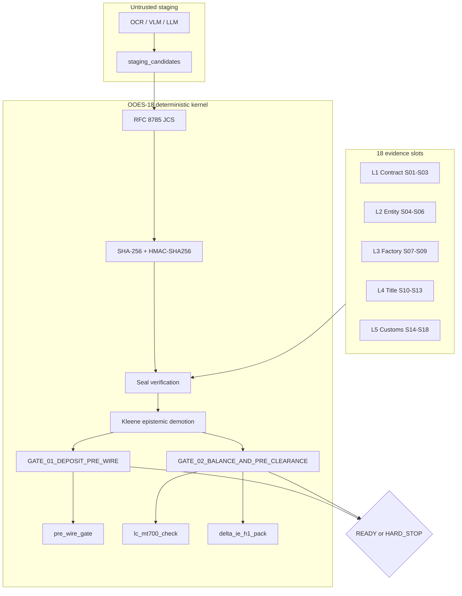

# OOES-18

## An Open Deterministic Evidence Schema for EU Regulation 2024/3015 and French DELTA IE (H1) Pre-Clearance

**Specification version:** 1.0.0 (October 2026)  
**Author:** Mohammad Anwaruzzaman  
**ORCID:** [0009-0004-5697-7634](https://orcid.org/0009-0004-5697-7634)  
**Institutional affiliation:** Founder & Chief Architect, First Order Technologies SAS (Paris, France - in incorporation)  
**Companion empirical dataset:** DS-PR412, SSRN [#6661398](https://ssrn.com/abstract=6661398)  
**Reference production engine:** `@foin/crisis-engine` (112,864 LoC monorepo, 1,329 deterministic kernel assertions, 99.21% assertion pass rate)

**License:** Written specification (`README.md`, `spec/`) is CC-BY-4.0. Schemas, test vectors, reference verifier, and tests (`schema/`, `vectors/`, `src/`, `tests/`) are Apache-2.0. See [LICENSE](LICENSE).

---

> *"A model reads. A compiled kernel decides."*

OOES-18 is an open, deterministic evidence schema for cross-border manufacturing orders. It fixes 18 evidentiary slots across five layers, a strict three-valued epistemic lattice, two release gates, and a cryptographic sealing protocol built from RFC 8785 JCS, RFC 5869 HKDF-SHA256, HMAC-SHA256, and AES-256-GCM. Probabilistic extraction may populate an untrusted staging area, but no confidence score, fuzzy match, or heuristic weight is permitted in the release path. The release predicate is total and deterministic:

```text
Gamma : D -> {READY, HARD_STOP} x P(R_halt)
```

The repository ships a zero-runtime-dependency TypeScript verifier, a mathematically authentic test vector generated by Node's `crypto` engine, a Draft 2020-12 JSON Schema, and an automated test suite proving seal integrity, epistemic demotion, cross-slot reconciliation, and blind-index collision behavior.

---

## 1. Regulatory Context: Three European Mandates Converge

European import compliance is moving from document inspection after cargo has sailed to structured, machine-verifiable evidence before capital is released. Three regimes create the demand for OOES-18.

### 1.1 EU Forced Labour Regulation (EU) 2024/3015

Regulation (EU) 2024/3015 entered into force on **13 December 2024** and becomes strictly enforceable from **14 December 2027**. It empowers EU customs authorities to detain, prohibit, or withdraw goods where forced labour is suspected anywhere in the value chain. For apparel and workwear importers, the operational risk is not only a named factory. It is opaque unauthorized sub-tier subcontracting: a compliant tier-1 factory can route production to an unregistered shadow unit that never appears in the purchase order, the audit, or the origin statement.

OOES-18 addresses this by requiring a corroborated supplier KYB slot (`L2.S04`), a registry-standing and forced-labour screening slot (`L2.S05`), and a capacity attestation that explicitly records `subcontracting_authorized: false` plus tier-2 mill tax identifiers (`L2.S06`). `GATE_01_DEPOSIT_PRE_WIRE` blocks the Day-0 30% advance unless all three are independently corroborated.

### 1.2 French DGDDI DELTA IE Volet Import (H1)

French customs replaced DELTA G/X with **DELTA IE Volet Import (H1)** under the EU UCC Customs Data Model. Since **30 September 2025**, H1 pre-arrival declarations are mandatory across French ports including Le Havre and Marseille-Fos. The declaration requires structured data elements that legacy invoice PDFs do not reliably provide: declared value and Incoterms breakdown, 10-digit TARIC code, preferential and non-preferential origin, supporting document codes, importer EORI, exporter identity, container number, and ISO 17712 seal number.

OOES-18 maps directly to those data elements in the `delta_ie_h1_pack` institutional view. The mapping is normative. The same evidence that clears the treasury gate also populates the customs pre-clearance pack.

### 1.3 Ecodesign for Sustainable Products Regulation (ESPR) (EU) 2024/1781

ESPR introduces the Textile Digital Product Passport (DPP). A credible DPP requires batch-level chemical evidence (REACH Annex XVII), fiber composition, and origin provenance. OOES-18 places the ISO/IEC 17025 laboratory certificate at `L3.S09`, including azo-dye concentration, measured cotton percentage, REACH compliance, and the DPP unique identifier. The technical pack at `L1.S02` carries the fiber and GSM baseline. The gate compares the measured value to the specification rather than trusting a self-declared label.

### 1.4 The structural gap

These mandates share a common demand: origin and product claims must be independently corroborated, not merely asserted. Existing document workflows produce assertions. OOES-18 produces a deterministic epistemic state.

---

## 2. Empirical Anchor: DS-PR412

The companion dataset paper **DS-PR412** (SSRN [#6661398](https://ssrn.com/abstract=6661398)) analyzes **n = 412** cross-border manufacturing orders across **six Asian trade corridors** from **2011 to 2024**.

| Measure | Value |
| :--- | :--- |
| Orders analyzed | 412 |
| Adverse operational/documentary event rate | **14.28%** |
| Adverse events | **59 / 412** (approximately 1 in 7) |
| Mean epistemic verification gap | **75 days** |
| Gap definition | Day-0 advance telegraphic transfer (30% T/T deposit) to Day-75 destination port arrival |
| Failure classes | Quality defects, unauthorized shadow subcontracting, late or forged shipping documents, TARIC/origin misclassification |

The 75-day gap is the core structural problem. At `t_0`, the importer wires 30% of contract value against promises and paper. At `t_75`, the cargo arrives and the physical truth becomes observable. For 75 days, capital is exposed to evidence that has not been independently verified.

Legacy post-presentation bank OCR operates at `t_45` to `t_60`, after capital is deployed and the vessel has sailed. It can detect a discrepancy in a PDF, but it cannot establish that the factory that produced the goods is the factory that was audited, that the container was stuffed at the declared geofence, or that the laboratory reading was not altered after capture. Consortium trade-finance blockchains (Marco Polo, we.trade, TradeLens) addressed ledger sharing, not local origin capture. They failed commercially for governance, onboarding, and incentive reasons, and placing commercial metadata on a shared ledger did not solve the duplicate-pledge problem under privacy constraints.

OOES-18 is deliberately narrower. It standardizes the evidence object, the epistemic state, the deterministic gate, and the cross-lender collision token. It does not require a consortium ledger.

The reference production engine `@foin/crisis-engine` provides the operational evidence base: 112,864 lines of code in a production monorepo, 1,329 deterministic kernel assertions, and a 99.21% assertion pass rate.

---

## 3. Architecture

### 3.1 Five layers, eighteen slots

| Layer | Purpose | Slots |
| :--- | :--- | :--- |
| **L1 Contract** | Commercial intent and the physical baseline | `S01` Purchase Order, `S02` Tech Pack/BOM, `S03` Golden Sample |
| **L2 Entity** | Who the supplier is and whether it is allowed to produce | `S04` Supplier KYB, `S05` Registry Standing, `S06` Capacity Attestation |
| **L3 Factory** | Proof that production physically occurred at the declared site | `S07` Geotagged Media, `S08` Inline AQL, `S09` ISO 17025 Lab Certificate |
| **L4 Title** | Custody, transport, origin, and settlement instruments | `S10` Bolt Seal, `S11` Bill of Lading, `S12` Certificate of Origin, `S13` Settlement Instrument |
| **L5 Customs** | Valuation, duty, inspection, telemetry, and the state root | `S14` Landed Valuation, `S15` Duty Calculation, `S16` PSI Report, `S17` GPS Telemetry, `S18` Audit Signature |

Each slot is exactly one of `UNKNOWN`, `ASSERTED`, or `CORROBORATED`. A mandatory slot in `UNKNOWN` or `ASSERTED` cannot satisfy a release gate that requires `CORROBORATED`.

### 3.2 Epistemic lattice

```text
UNKNOWN (0)  <  ASSERTED (1)  <  CORROBORATED (2)
```

The lattice is Kleene's strong three-valued logic restricted to a bounded chain:

- **UNKNOWN:** missing, unsubmitted, expired, structurally invalid, or cryptographically unauthenticated. Never coerced to truthy.
- **ASSERTED:** structurally valid and signed by an interested party with capture provenance, but not independently attested.
- **CORROBORATED:** structurally valid, cryptographically sealed, and independently attested by an accredited third party or authority with a verified accreditation identifier and a non-expired signature.

A seal mismatch or an expired attestation forces immediate demotion to `UNKNOWN` with `ERR_SEAL_INTEGRITY_FAILURE` or `ERR_ATTESTATION_EXPIRED`.

### 3.3 Two deterministic release gates



| Gate | Trigger | Mandatory slots | Key semantic rules |
| :--- | :--- | :--- | :--- |
| `GATE_01_DEPOSIT_PRE_WIRE` | Day-0 30% T/T advance | `S01-S06` | Sanctions clear, EU 2024/3015 screening `CLEAR`, subcontracting unauthorized, capacity positive |
| `GATE_02_BALANCE_AND_PRE_CLEARANCE` | Pre-shipment / UCP 600 presentation / DELTA IE H1 | Core `S01,S02,S03,S04,S07,S08,S09,S10` + reconciliation `S11,S12,S14,S15` | Geofence <= 500 m, AQL pass, REACH and azo < 30 ppm, cotton tolerance, container continuity, clean on board, origin and REX consistency, CIF arithmetic, TARIC format |

### 3.4 Cryptographic protocol

1. **RFC 8785 JCS** canonicalizes every payload. Object keys are sorted by UTF-16 code units, arrays keep order, numbers use ECMA-262 serialization, and non-finite numbers are rejected.
2. **RFC 5869 HKDF-SHA256** derives a distinct 32-byte slot key from the tenant master secret, a 16-byte dossier salt, and the info string `OOES-18|v1|<tenant>|<dossier>|<slot>`.
3. **HMAC-SHA256** produces the deterministic slot authentication digest over the canonical payload.
4. **AES-256-GCM** encrypts the payload at rest with a 12-byte IV and AAD `<dossier>|<slot>|<state>`.
5. **Dossier state root** at `L5.S18` hashes the ordered `S01..S17` tuple of slot identifier, state, and authenticated digest.
6. **Salted blind index** normalizes the shipment tuple `(B/L, container, supplier tax ID, invoice date)`, strips spaces and hyphens from the container and tax identifier, and emits `HMAC-SHA256(network_registry_salt, normalized_tuple)`. Two banks can detect the same shipment without sharing tenant keys or commercial plaintext.

---

## 4. Repository Map

```text
.
├── README.md
├── LICENSE
├── package.json
├── tsconfig.json
├── schema/
│   └── ooes-18.schema.json                  Draft 2020-12, strict, 18 slot payloads
├── spec/
│   ├── OOES-18-Specification-v1.0.md        Full technical specification
│   ├── OOES-18-Paper.tex                    4-page two-column SSRN preprint source
│   └── OOES-18-Paper.pdf                    Compiled 4-page preprint
├── src/
│   ├── verifier.ts                          Zero-dependency deterministic kernel
│   ├── seal-vector.ts                       Authentic vector generator
│   └── cli.ts                               verify / tamper-demo forensic CLI
├── tests/
│   └── verifier.test.ts                     11 node:test assertions
└── vectors/
    └── CASCADE-2026-9F4A2C.dossier.json     Authentic Dhaka -> Le Havre dossier
```

The compiled verifier imports only Node built-ins: `node:crypto`, `node:fs`, `node:path`, `node:test`, and `node:assert/strict`. There are no runtime dependencies.

---

## 5. Quickstart

```bash
npm install
npm run build
npm run seal-vector
npm test
npm run verify
npm run tamper-demo
```

`npm run seal-vector` regenerates `vectors/CASCADE-2026-9F4A2C.dossier.json` from the pinned test keys. Every digest, authentication tag, state root, and blind index in that file is computed by Node's cryptographic engine; no hexadecimal value is hand-authored.

### 5.1 Test results

```text
# tests 11
# suites 0
# pass 11
# fail 0
# cancelled 0
# skipped 0
# todo 0
```

The suite covers:

1. RFC 8785 key-order invariance, Unicode escaping, ECMA-262 numbers, and rejection of `NaN`, `Infinity`, `undefined`, non-plain objects, and cycles.
2. HKDF-SHA256 domain separation across tenant, dossier, and slot identifiers.
3. Authentic seal verification for all 18 slots in `CASCADE-2026-9F4A2C`.
4. Default gate failure with the exact `ASSERTED` and `UNKNOWN` slot sets.
5. Full corroboration promotion to `READY` on both gates.
6. Semantic rejection with valid seals: container mismatch, geofence violation, and CIF arithmetic error.
7. Cross-bank blind-index collision under formatting mutation.
8. Single-byte tamper demotion and `GATE_02` halt.
9. Deterministic repeatability of both gates and the seal report.

### 5.2 `npm run verify`

The default vector represents a Dhaka (`BDCGP`) to Le Havre (`FRLEH`) shipment of 12,000 men's 100% cotton twill workwear jackets (290 GSM, TARIC `6203321000`, FOB EUR 144,000.00, freight EUR 4,200.00, insurance EUR 300.00, CIF EUR 148,500.00). It contains exactly **8 CORROBORATED, 4 ASSERTED, and 6 UNKNOWN** slots.

```text
========================================================================
 OOES-18 v1.0.0 :: OPEN ORIGIN EVIDENCE SCHEMA
 A model reads. A compiled kernel decides.
========================================================================
 dossier_id        : CASCADE-2026-9F4A2C
 tenant_id         : TENANT-FR-IMPORT-75008
 reference_time    : 2026-10-20T12:00:00Z
 dossier state root: a426317f4ddc9f4ca7a86e36baa2c53099abbc600af6fa9635ee9b2ce5473321
 seal verification : SEAL INTEGRITY OK (18 SLOTS EVALUATED)
```

A forensic table prints all 18 slots. The default outcome is intentionally blocked:

```text
GATE_01_DEPOSIT_PRE_WIRE
  verdict         : HARD_STOP
  mandatory slots : 6
  corroborated    : 4/6
  uncorroborated  : L2.S05_REGISTRY_STANDING (ASSERTED), L2.S06_CAPACITY_ATTESTATION (ASSERTED)

GATE_02_BALANCE_AND_PRE_CLEARANCE
  verdict         : HARD_STOP
  mandatory slots : 12
  corroborated    : 8/12
  uncorroborated  : L4.S11_BILL_OF_LADING (ASSERTED), L4.S12_CERTIFICATE_OF_ORIGIN (ASSERTED), L5.S14_LANDED_VALUATION (UNKNOWN), L5.S15_DUTY_CALCULATION (UNKNOWN)
```

The blind index for the vector is:

```text
normalized tuple : MAEU260984112|MSCU5829104|BDBIN0049182730101|2026-10-12
blind index      : c1d26a183bd01045931d072f8832624a5d31e5a36c768c276d5425d0907ba4d5
```

### 5.3 `npm run tamper-demo`

The tamper demonstration changes the laboratory azo-dye reading from a compliant `4.2` ppm to `45.2` ppm in memory. The attacker possesses the dossier bytes but not the tenant master secret, so the HKDF-derived slot key, HMAC, and AES-GCM tag cannot be forged.

```text
[CRITICAL] SLOT L3.S09_LAB_CERTIFICATE: HMAC-SHA256 DIGEST MISMATCH -> EPISTEMIC DEMOTION (CORROBORATED -> UNKNOWN) -> GATE_02 HARD_STOP

FORENSIC DETAIL
  declared state        : CORROBORATED
  effective state       : UNKNOWN
  JCS SHA-256           : MISMATCH
  HMAC-SHA256           : MISMATCH
  AES-256-GCM           : INVALID
  fault codes           : ERR_SEAL_INTEGRITY_FAILURE, ERR_AES_GCM_AUTH_FAILURE
```

The command exits `0` only when the demotion and `GATE_02` halt are observed.

---

## 6. Schema

`schema/ooes-18.schema.json` is a strict Draft 2020-12 schema. It defines:

- The `OOES18Dossier` root with `additionalProperties: false`.
- `$defs/EpistemicState`, `$defs/CryptographicSeal`, and `$defs/AttestationMetadata`.
- All 18 slot envelopes, each with a closed payload schema.
- State-conditioned requirements: `UNKNOWN` slots have null payload, seal, and attestation; `ASSERTED` and `CORROBORATED` slots require a payload, seal, and attestation; `CORROBORATED` additionally requires a non-party attester with an accreditation identifier.
- `$defs/BlindIndex` and the three institutional views.

The canonical vector validates against this schema under Ajv 2020-12:

```text
vectors/CASCADE-2026-9F4A2C.dossier.json valid
```

---

## 7. Institutional Output Views

One evidence graph produces three role-specific outputs. There is no separate reconciliation logic per institution.

### View A: `pre_wire_gate`

For corporate ERPs and payment orchestration. It returns the gate verdict, the 30% advance amount, the mandatory slot set, and every enumerated halt reason. If `GATE_01` is `HARD_STOP`, the ERP must not release the wire.

### View B: `lc_mt700_check`

Maps OOES-18 checks to UCP 600 Articles 14(d), 18, 20, 27, and 30, and to ISBP 821 paragraphs C1, E1, K1, and L1. It produces a pre-presentation discrepancy matrix before documents reach the negotiating bank. This is materially earlier than post-presentation OCR.

### View C: `delta_ie_h1_pack`

Maps slots to French DELTA IE H1 data elements:

| DELTA IE H1 data element | OOES-18 source |
| :--- | :--- |
| `DE 11 01` Declaration type `H1` | `L5.S15` |
| `DE 12 03` Supporting documents (`N380`, `N705`, `U164`/`N865`, ISO 17025 lab certificate, forced-labour attestation) | `L1.S01`, `L3.S09`, `L4.S11`, `L4.S12`, `L5.S14` |
| `DE 13 01` Exporter identity and address | `L2.S04` |
| `DE 13 04` Importer EORI | `L1.S01` |
| `DE 14 03` Customs value and Incoterms breakdown | `L5.S14` |
| `DE 16 08 / 16 09` Non-preferential and preferential origin | `L4.S12` |
| `DE 18 09` 10-digit TARIC commodity code | `L5.S15` |
| `DE 19 01 / 19 07` Container identification and ISO 17712 seal | `L4.S10`, `L4.S11` |

---

## 8. Security Boundary: The Oracle Boundary Theorem

**Theorem (Oracle Boundary).** A cryptographic digest, HMAC, or AES-GCM tag proves capture provenance, tenant isolation, and post-capture byte immutability. It does not, by itself, prove physical ground truth.

A valid seal on `L3.S09_LAB_CERTIFICATE` proves that the bytes attributed to Bureau Veritas CPS Dhaka were sealed under the tenant's derived slot key and have not changed since sealing. It does not prove that the cotton was tested, that the sample came from the declared batch, or that the laboratory accreditation is unrevoked. Those are institutional facts.

Physical ground truth enters OOES-18 only through the epistemic transition from `ASSERTED` to `CORROBORATED`:

- Independent ISO/IEC 17020 inspection at `L3.S08` (inline AQL) and `L5.S16` (pre-shipment).
- Independent ISO/IEC 17025 testing at `L3.S09` (chemical and fiber).
- Geofenced capture at `L3.S07` (EXIF GPS within 500 m of the KYB coordinates), `L4.S10` (stuffing geolocation), and `L5.S17` (origin-to-port telemetry).
- Carrier or port-community corroboration of `L4.S11` (eBL registry) and sovereign corroboration of `L2.S05`, `L4.S12`, and `L5.S15`.

The cryptographic layer protects the evidence after capture. The accreditation layer establishes that the capture was performed by a party with the institutional competence to observe the physical fact. Both are necessary; neither is sufficient alone.

---

## 9. Reproducibility

The test vector is regenerated deterministically from the pinned fixtures:

| Fixture | Value |
| :--- | :--- |
| Dossier ID | `CASCADE-2026-9F4A2C` |
| Tenant ID | `TENANT-FR-IMPORT-75008` |
| Tenant master secret (test only) | `0102030405060708090a0b0c0d0e0f101112131415161718191a1b1c1d1e1f20` |
| HKDF salt (test only) | `a1b2c3d4e5f60718293a4b5c6d7e8f90` |
| Network registry salt (test only) | `f0e1d2c3b4a5968778695a4b3c2d1e0ff0e1d2c3b4a5968778695a4b3c2d1e0f` |
| State root | `a426317f4ddc9f4ca7a86e36baa2c53099abbc600af6fa9635ee9b2ce5473321` |
| Blind index | `c1d26a183bd01045931d072f8832624a5d31e5a36c768c276d5425d0907ba4d5` |

These secrets are public test fixtures. Production deployments MUST use a 32-byte tenant secret generated by a CSPRNG and stored in an HSM or equivalent key-management boundary. The network registry salt is shared by participating lenders; it is not a tenant secret.

The test vector is not a production certificate. It exists to prove that two independent implementations of OOES-18 can derive identical keys, identical digests, identical state roots, and identical gate verdicts.

---

## 10. Citation

### 10.1 OOES-18 v1.0.0

**BibTeX**

```bibtex
@techreport{anwaruzzaman2026ooes18,
  author       = {Anwaruzzaman, Mohammad},
  title        = {{OOES-18}: An Open Deterministic Evidence Schema for {EU}
                  Regulation 2024/3015 and {French} {DELTA} {IE} ({H1})
                  Pre-Clearance},
  institution  = {First Order Technologies SAS},
  type         = {Open Technical Specification},
  number       = {OOES-18 v1.0.0},
  year         = {2026},
  month        = {October},
  address      = {Paris, France},
  note         = {ORCID 0009-0004-5697-7634; Apache-2.0 schema and verifier,
                  CC-BY-4.0 specification}
}
```

**APA 7th**

> Anwaruzzaman, M. (2026). *OOES-18: An open deterministic evidence schema for EU Regulation 2024/3015 and French DELTA IE (H1) pre-clearance* (Version 1.0.0) [Technical specification]. First Order Technologies SAS.

### 10.2 DS-PR412

**BibTeX**

```bibtex
@techreport{anwaruzzaman2026dspr412,
  author       = {Anwaruzzaman, Mohammad},
  title        = {{DS-PR412}: Cross-Border Manufacturing Order Evidence Dataset,
                  2011--2024},
  institution  = {First Order Technologies SAS},
  type         = {SSRN Working Paper},
  number       = {6661398},
  year         = {2026},
  address      = {Paris, France},
  note         = {n = 412 orders; six Asian trade corridors; 14.28\% adverse
                  event rate; 75-day epistemic verification gap; ORCID
                  0009-0004-5697-7634},
  url          = {https://ssrn.com/abstract=6661398}
}
```

**APA 7th**

> Anwaruzzaman, M. (2026). *DS-PR412: Cross-border manufacturing order evidence dataset, 2011-2024* [Working paper]. SSRN. https://ssrn.com/abstract=6661398

---

## 11. Author

**Mohammad Anwaruzzaman**

- Founder & Chief Architect, First Order Technologies SAS (Paris, France - in incorporation)
- Postgraduate Diploma in Industrial Production & Supply Chain, Arts et Métiers ParisTech (ENSAM, Paris)
- Former Research Fellow, Laboratory for Production Management and Processes, EPFL (Lausanne)
- ORCID: [0009-0004-5697-7634](https://orcid.org/0009-0004-5697-7634)

---

## 12. License

- `README.md`, `spec/`: **CC-BY-4.0**
- `schema/`, `vectors/`, `src/`, `tests/`: **Apache-2.0**

The Apache-2.0 grant is intentional. French *Commissionnaires en Douane* and *Représentants en Douane Enregistrés* (RDE), European trade-finance banks, credit insurers, and ERP vendors must be able to embed the verifier and schema without licensing friction.
